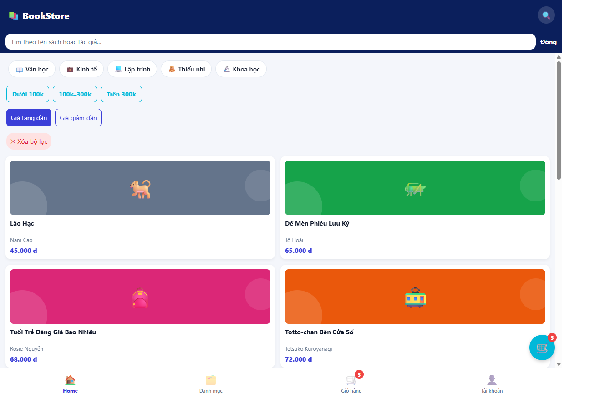

# Trả lời câu hỏi bổ sung Buổi 7

Sinh viên: Huỳnh Hoài Thanh — MSSV: 23633801.

## 1. Cấu trúc điều hướng

BookDetail được đăng ký trong Native Stack ngoài Tabs để màn Chi tiết phủ cả thanh tab và có nút quay lại tự động. Khi quay lại, Home vẫn giữ trạng thái tìm kiếm và vị trí cuộn. Nếu đặt BookDetail thành một màn trong Bottom Tab, nó trở thành một tab riêng, thanh tab vẫn xuất hiện và không tự có nút quay lại như Stack.

## 2. Redux và useMemo

Redux Toolkit dùng Immer, vì vậy lệnh `state.items.push(...)` thao tác trên bản nháp và Immer tạo state mới, giữ nguyên state cũ. Nếu bỏ `useMemo` trong `useCart`, tổng số lượng và tổng tiền vẫn đúng vì phép `reduce` không đổi. Khác biệt là các tổng sẽ được tính lại ở mọi lần render; `useMemo` chỉ tính lại khi mảng `items` thay đổi và là cách tối ưu hiệu năng.

## 3. Promise.all

Trong bản làm theo đề, nếu `getCategories()` lỗi nhưng `getBooks()` thành công thì Home vẫn hiển thị ErrorView vì `Promise.all` reject khi một request thất bại. Có thể thay bằng `Promise.allSettled`, kiểm tra trạng thái từng kết quả để vẫn hiển thị sách, bỏ phần danh mục bị lỗi và cho phép tải lại riêng phần đó. Cách này tăng khả năng sử dụng khi API lỗi một phần nhưng phải quản lý trạng thái tải, lỗi và thử lại riêng; người dùng cũng không thể chọn các danh mục chưa tải được.

## 4. Debounce

Nếu mỗi lần `onChangeText` đều tạo một `setTimeout` mà không hủy timer trước đó, mỗi phím vẫn dẫn đến một lần cập nhật bị trễ, chưa tạo ra debounce. Có thể xử lý trong sự kiện nếu tự quản lý timer bằng ref, nhưng dùng `useEffect` giúp tập trung vòng đời timer theo `value` và `delay`. Hàm dọn dẹp `clearTimeout` hủy lịch cũ khi gõ tiếp hoặc component unmount, tránh áp dụng từ khóa cũ và cập nhật sau khi màn hình đã gỡ.

## 5. Sắp xếp giá

Home đã có hai nút “Giá tăng dần” và “Giá giảm dần”; nhấn lại nút đang chọn để trở về thứ tự mặc định. Sắp xếp áp dụng sau khi lọc nên kết hợp được với từ khóa, danh mục và khoảng giá. Dùng bản sao mảng để không thay đổi dữ liệu gốc.

```tsx
const [sort, setSort] = useState<"asc" | "desc" | null>(null);
const visibleBooks = useMemo(() => {
  const filtered = filterBooks(books, {
    keyword: debouncedKeyword, categoryId, priceRange,
  });
  return sort === null ? filtered : [...filtered].sort((a, b) =>
    sort === "asc" ? a.price - b.price : b.price - a.price);
}, [books, debouncedKeyword, categoryId, priceRange, sort]);
```

Ảnh kết quả sắp xếp giá tăng dần:



## Thử thách C1 — Vì sao UI không phải sửa khi đổi thư viện state

Màn hình chỉ gọi giao diện `useCart`, `useAuth` và `useWishlist`, không gọi Redux action hoặc selector trực tiếp. Khi chuyển sang Zustand hoặc thư viện khác, chỉ cần thay phần triển khai các hook adapter và giữ nguyên tên hàm, tham số, giá trị trả về. Ví dụ nút yêu thích vẫn gọi `toggle(book.id)` và `isFavorite(book.id)` như cũ.

